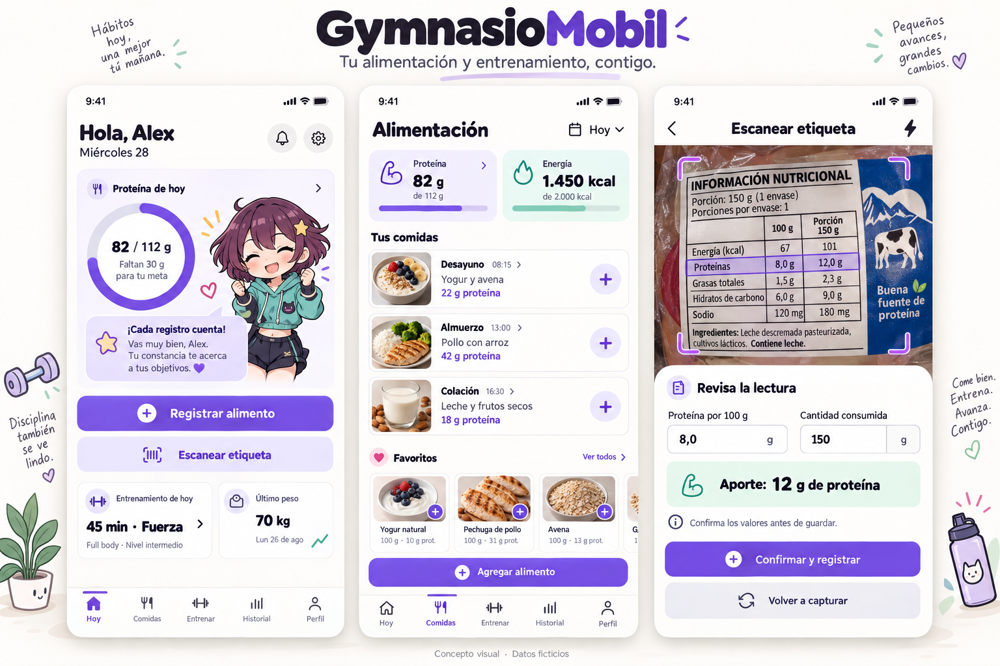
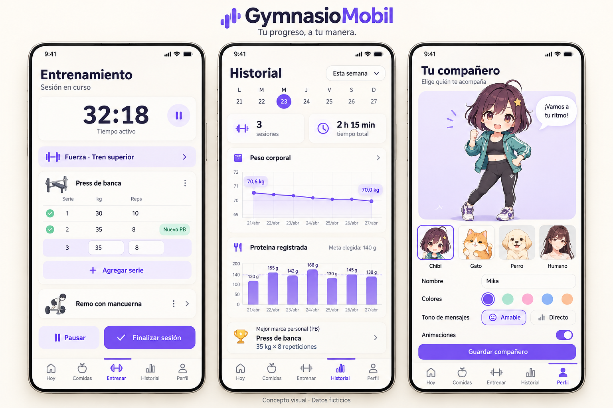

# Templates visuales UI/UX de GymnasioMobil

Plantillas de referencia para construir las pantallas y mantener una dirección visual común. Para una nueva variante, conservar los originales y crear una versión con otro nombre. Estas plantillas son imágenes estáticas; los componentes reutilizables se implementarán durante el desarrollo móvil.

Conceptos visuales generados el 28 de octubre de 2026 mediante la herramienta integrada de generación de imágenes (habilidad imagegen). Datos y productos ficticios. Son referencias de diseño estáticas.

## Láminas

1. [Inicio, alimentación y OCR](01-alimentacion-y-ocr.png).
2. [Entrenamiento, historial y compañero](02-entrenamiento-historial-personaje.png).





## Decisiones de experiencia

- Fondo claro, tipografía oscura, violeta para acciones principales y menta para estados informativos.
- Cinco secciones: Hoy, Comidas, Entrenar, Historial y Perfil.
- Registro rápido desde Hoy y revisión explícita de nutrientes, base y cantidad tras escanear.
- Entrenamiento con duración activa, series editables y PB visible.
- Historial con periodos, peso y proteína registrada.
- Personalización con chibi original, gato, perro y avatar humano; tono y animaciones configurables.

## Ajustes antes de implementar

Las imágenes son exploraciones independientes: cambian algunos iconos, proporciones y cifras. Unificar componentes y usar un único conjunto de datos al construir el prototipo. La meta del ejemplo de Hoy es 112 g; la gráfica de la segunda lámina usa otro ejemplo de 140 g, sin representar un perfil validado.

La cantidad tras el OCR la introduce el usuario. Los gráficos y referencias nutricionales son demostrativos. Adaptar metas y contenido por etapa de vida según el plan. Verificar contraste, tamaño de controles y lectura en teléfono al implementar; las imágenes no acreditan accesibilidad probada.

## Prompts originales

### Lámina 1

```text
Use case: ui-mockup. Create a polished high fidelity mobile app UX concept presentation for "GymnasioMobil", a Spanish Chilean nutrition and exercise app with an original customizable chibi companion. Landscape 3:2 image, very high resolution, three LARGE front-on mobile screens side by side, equal size, no perspective, almost no phone bezel, generous breathing room, warm off-white presentation background. Editorial heading "GymnasioMobil" and subtitle "Tu alimentación y entrenamiento, contigo." Small footer "Concepto visual · Datos ficticios". Modern accessible warm-white UI with deep charcoal typography, violet #7357DE primary, soft mint secondary, light lavender cards, rounded corners, crisp thin line icons, clear typographic hierarchy. Design credible usable screens, restrained decoration, no gradients overload, all text in correct Spanish.
Left screen "Hoy", greeting "Hola, Alex", date "Miércoles 28". Beautiful protein progress ring and text "82 / 112 g", "Faltan 30 g para tu meta". A SMALL friendly original anime chibi girl companion with short plum hair, teal sporty hoodie, star hair clip, distinctly original not Kasane Teto, beside a lavender message card "¡Cada registro cuenta!". Main buttons "Registrar alimento", secondary "Escanear etiqueta". Cards "Entrenamiento de hoy", "45 min · Fuerza", and "Último peso", "70 kg". Five bottom tabs "Hoy", "Comidas", "Entrenar", "Historial", "Perfil", Hoy active.
Middle screen "Alimentación", date "Hoy", summary chips "Proteína 82 g", "Energía 1.450 kcal", section "Tus comidas". Attractive realistic small food thumbnails next to rows "Desayuno", "Yogur y avena", "22 g proteína"; "Almuerzo", "Pollo con arroz", "42 g proteína"; "Colación", "Leche y frutos secos", "18 g proteína". Clear "+" row add buttons. Section "Favoritos" with small reusable food cards. Primary bottom button "Agregar alimento". Same five bottom tabs Comidas active.
Right screen "Escanear etiqueta". Camera capture area showing fictional Chilean food packaging label close-up within violet crop corner guides; readable fictional table header "INFORMACIÓN NUTRICIONAL", columns "100 g", "Porción 150 g", row "Proteínas", "8,0 g", "12,0 g". Below camera, a clean editable confirmation card title "Revisa la lectura", fields "Proteína por 100 g" value "8,0 g"; "Cantidad consumida" value "150 g"; calculated result "Aporte: 12 g de proteína". Small helper "Confirma los valores antes de guardar". Primary "Confirmar y registrar", secondary "Volver a capturar". No claim photo weighs food. Consistent professional mobile product design; detailed UI must remain legible at large scale.
```

### Lámina 2

```text
Use case: ui-mockup. Create a polished high fidelity mobile app UX concept presentation for "GymnasioMobil", a Spanish Chilean nutrition and exercise app with customizable companion. Landscape 3:2 image, very high resolution, three LARGE front-on mobile screens side by side, identical dimensions, no perspective, almost no phone bezel, generous breathing room, warm off-white presentation background. Editorial heading "GymnasioMobil" subtitle "Tu progreso, a tu manera." Small footer "Concepto visual · Datos ficticios". Consistent modern accessible warm-white UI, charcoal typography, violet #7357DE primary, soft mint secondary, light lavender cards, rounded corners, crisp line icons, clear typographic hierarchy. Restrained decoration. All text Spanish and readable.
Left screen "Entrenamiento", tiny subtitle "Sesión en curso". Large timer "32:18", smaller "Tiempo activo". Card "Fuerza · Tren superior". Exercise "Press de banca", table headers "Serie", "kg", "Reps", completed rows "1 · 30 · 10", "2 · 35 · 8", editable current "3 · 35 · 8". mint small badge "Nuevo PB" next to completed second set. Secondary button "+ Agregar serie". Next exercise compact "Remo con mancuerna". Buttons pause icon "Pausar" and violet "Finalizar sesión". Five bottom tabs "Hoy", "Comidas", "Entrenar", "Historial", "Perfil", Entrenar active. No clutter.
Middle screen "Historial", period selector "Esta semana", small calendar strip "L M M J V S D" with violet selected day. Summary cards "3 sesiones", "2 h 15 min". Wide chart "Peso corporal", elegant violet line trending 70,6 to 70,0 kg over dates, no moral judgement. Protein chart title "Proteína registrada" with seven violet bars and subtle dotted reference line, label "Meta elegida". Compact PB card trophy outline "Press de banca", "35 kg × 8 repeticiones". Bottom tabs Historial active.
Right screen "Tu compañero", subtitle "Elige quién te acompaña". Friendly beautifully drawn ORIGINAL chibi anime girl full character standing in main lavender preview area, short plum bob hair, tiny star hair clip, teal sports hoodie, black leggings, sneakers, friendly face, no recognizable copyrighted character. Small adjacent preview speech balloon "¡Vamos a tu ritmo!". Horizontal character selection thumbnails 4 choices labelled "Chibi", "Gato", "Perro", "Humano". Cute round orange cat and cream puppy clearly depicted in their thumbnails, chibi selected with violet outline. Fields "Nombre" value "Mika", color swatch selector "Colores", tone selector "Amable" and "Directo", visible toggle "Animaciones". Primary button "Guardar compañero". Bottom tabs Perfil active.
Professional believable app UI/UX concept, useful readable screens, character secondary to information except customization page, fictional data, no medical claims, high visual craftsmanship.
```
