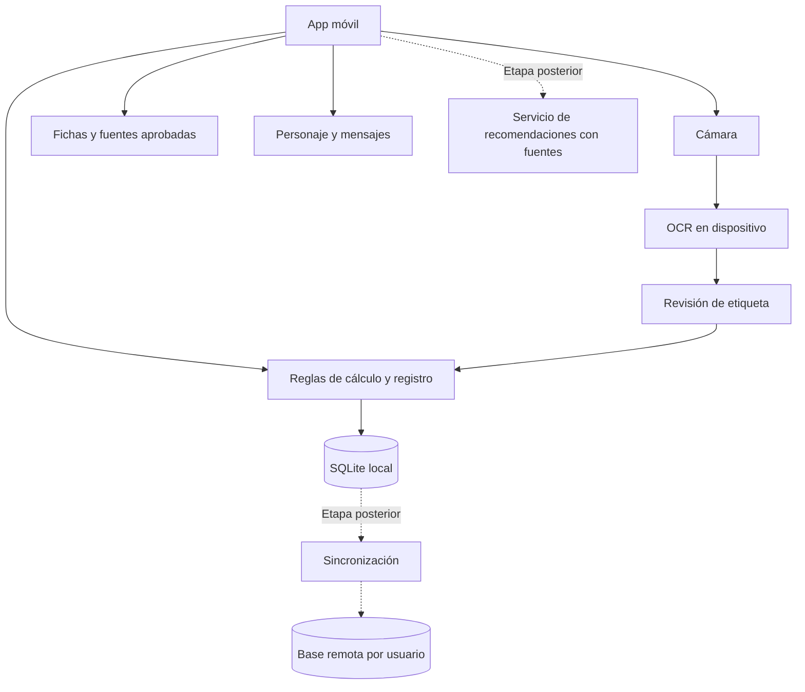

# Arquitectura propuesta

## Decisión inicial

**React Native + Expo + TypeScript**, con SQLite local y un módulo OCR reemplazable. Es una recomendación de diseño para este proyecto, no una elección irreversible.

Expo ofrece cámara y SQLite; las compilaciones de desarrollo permiten incorporar módulos nativos adicionales. El reconocimiento de texto debe evaluarse aparte: tener cámara no significa tener un lector de tablas nutricionales. Referencias: [cámara](https://docs.expo.dev/versions/latest/sdk/camera/), [SQLite](https://docs.expo.dev/versions/latest/sdk/sqlite/) y [development builds](https://docs.expo.dev/develop/development-builds/introduction/).

| Opción | Cuándo la elegiría | Costo para este proyecto |
| --- | --- | --- |
| React Native + Expo | Si quieres trabajar en TypeScript y compartir lógica entre plataformas | Verificar compatibilidad del módulo OCR con la versión elegida |
| Flutter + Dart | Si prefieres Dart o priorizas un sistema visual muy personalizado | Aprender y mantener Dart; también requiere validar plugins nativos |
| Android/iOS nativos separados | Si el producto depende de funciones muy específicas de cada sistema | Dos implementaciones y mayor mantenimiento |

Flutter también permite aplicaciones multiplataforma desde una base de código. [Documentación oficial](https://docs.flutter.dev/platform-integration).

No fijar números de versión hasta iniciar el proyecto. Elegir versiones estables compatibles, conservar el archivo de dependencias bloqueadas y probar cámara/OCR en un teléfono real antes de comprometer la arquitectura.

## Componentes

| Capa | Responsabilidad |
| --- | --- |
| Pantallas y componentes | Mostrar datos, capturar acciones y estados accesibles |
| Funciones de producto | Alimentación, entrenamientos, historial, perfil, personaje y conocimiento |
| Dominio | Conversiones, totales, metas, PB y validación; sin depender de cámara o IA |
| Datos | Escrituras transaccionales, consultas, copias, migraciones y repositorios |
| Servicios | Adaptadores de cámara, OCR, notificaciones y futuras consultas remotas |
| Contenido | Fuentes revisadas, mensajes y definiciones de personajes versionadas |

## Persistencia y funcionamiento sin conexión

La primera versión guarda localmente. Registrar comidas, entrenamientos y consultar información ya descargada debe funcionar sin internet. SQLite por sí solo no proporciona sincronización ni cifrado integral: esas capacidades requieren diseño y pruebas propios.

Las escrituras de un consumo y su resumen se hacen de forma atómica, o el resumen se deriva de los consumos. No mantener dos totales independientes. Cada cambio de esquema necesita una migración probada con datos anteriores y una estrategia de recuperación.

Exportación JSON versionada para copia/restauración, CSV para lectura externa. Importar primero a un área de validación y evitar duplicados por identificador. Advertir claramente que una exportación contiene información personal.

## OCR

Evaluar ML Kit Text Recognition v2 con un adaptador nativo compatible con Expo. ML Kit reconoce texto; la app debe reconstruir filas, columnas y unidades. [Documentación oficial](https://developers.google.com/ml-kit/vision/text-recognition/v2).

La prueba inicial debe resolver instalación, funcionamiento sin conexión, texto con coma decimal y lectura de bloques/posiciones. No seleccionar un paquete comunitario por nombre sin comprobar mantenimiento, licencia y compatibilidad. Usar development build cuando el módulo nativo lo requiera; no basar la entrega OCR únicamente en Expo Go.

## Nube, en otra etapa

Supabase es candidato para autenticación, PostgreSQL y almacenamiento. Aplicar aislamiento por usuario mediante políticas RLS y probar accesos permitidos y denegados. [Documentación RLS](https://supabase.com/docs/guides/database/postgres/row-level-security).

La sincronización requerirá cola local de operaciones, identificadores únicos, reintentos idempotentes, versiones de registros y marcas de eliminación. Los conflictos de edición de comidas deben ser visibles o resolverse con reglas documentadas; no combinar cantidades silenciosamente.

Las claves privadas de servicios de IA viven en el servidor. El móvil sólo recibe permisos limitados. Los datos enviados para una recomendación deben ser los mínimos necesarios y con una opción clara de uso local.

## Desarrollo desde Windows

Priorizar un teléfono Android real. Para iOS se puede evaluar EAS Build, que compila en infraestructura macOS remota; la validación de cámara, permisos y OCR también requiere pruebas iOS. [EAS Build](https://docs.expo.dev/build/introduction/). El presupuesto y las credenciales de distribución se definen cuando se prepare la beta.

## Datos personales

Diseñar desde el inicio exportación, borrado y minimización de información. No registrar fotos, peso o conversaciones en logs de errores. Pedir acceso a cámara al iniciar el escaneo. Conservar la foto de etiqueta sólo si el usuario elige hacerlo; eliminar archivos temporales después de procesarlos.

Si se habilita nube, documentar cifrado en tránsito, protección de almacenamiento, retención y eliminación también de copias. Verificar requisitos de privacidad y tiendas vigentes antes de publicar. Este plan no declara cumplimiento legal ni una certificación sanitaria.
