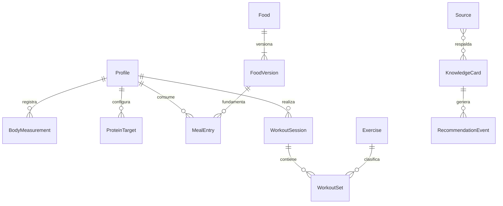

# Modelo de datos inicial

Diseño conceptual; no es un esquema SQL aplicado. Usar identificadores UUID, fechas ISO y unidades explícitas. Datos numéricos ausentes son `null`, nunca cero por defecto.

## Entidades

| Entidad | Campos principales | Relación / propósito |
| --- | --- | --- |
| Profile | id, locale, timezone, units, goal_type, age_group, recommendation_context | Dueño local de registros; etapa de vida para adaptar contenido; cuenta remota opcional después |
| BodyMeasurement | id, profile_id, measured_at, weight_kg, note | Serie de peso corporal; medidas adicionales futuras |
| ProteinTarget | id, profile_id, effective_from, target_g, method, factor, reference_weight_kg, measurement_id, evidence_version | Metas versionadas; meta manual permite factor y fuente nulos |
| Food | id, owner_id, name, brand, barcode, current_version_id, archived_at | Identidad estable del alimento |
| FoodVersion | id, food_id, version, basis_amount, basis_unit, portion_amount, portion_unit, nutrients, preparation_state, origin, confirmed_at | Etiqueta o entrada manual inmutable tras uso |
| FoodServing | id, food_version_id, label, quantity, unit, source | Equivalencias específicas: porción, scoop o unidad |
| MealEntry | id, profile_id, food_version_id, consumed_at, local_date, timezone, meal_type, quantity, unit, portion_count, quantity_method, estimated_range, nutrient_snapshot, target_id | Evento de consumo; guarda valores usados al calcular |
| OcrScan | id, status, raw_text, field_candidates, validation_flags, engine_version, image_path_optional, confirmed_food_version_id | Evidencia técnica del escaneo; retención limitada |
| Exercise | id, name, modality, equipment, variant, load_convention | Define qué series pueden compararse |
| WorkoutSession | id, profile_id, started_at, ended_at, timezone, status, elapsed_seconds, active_seconds, note | Sesión en curso o cerrada |
| SessionInterval | id, session_id, start_at, end_at, type | Distingue actividad y pausa; recuperación tras cierre |
| WorkoutSet | id, session_id, exercise_id, order, load_kg, reps, duration_seconds, distance_m, is_warmup, completed_at | Datos según modalidad; RPE/RIR se añaden después |
| PersonalBest | id, profile_id, exercise_id, metric, value, unit, comparison_key, source_set_id, source_session_id, rule_version, achieved_at | Registro derivado recalculable; no verdad independiente |
| CompanionProfile | id, profile_id, character_id, name, appearance, tone, enabled, motion_enabled | Configuración del motivador |
| Source | id, title, authors, year, url, doi, source_type, population, limitations, reviewed_at, status | Referencia original |
| KnowledgeCard | id, version, topic, statement, applicability, limitations, source_ids, source_locations, review_status | Recomendación curada publicable |
| RecommendationEvent | id, profile_id, card_version, context_summary, shown_at | Explicación de qué recomendación se mostró |
| ChangeEvent | id, entity_type, entity_id, operation, changed_at | Auditoría mínima sin duplicar información sensible innecesaria |

Reservar para sincronización: `owner_id`, `revision`, `updated_at`, `deleted_at`, `device_id` y `operation_id`, con políticas precisas antes de implementarla. Una colección local no necesita correo ni inicio de sesión.

## Relaciones principales

## Reglas del historial

1. Editar una etiqueta crea otra versión. No cambiar los nutrientes de consumos pasados automáticamente.
2. Guardar en el consumo una copia de nutrientes calculados, método, cantidad y versión. Una corrección explícita del consumo recalcula ese evento.
3. Vincular cada día con la meta vigente. Cambiar una meta crea una vigencia nueva; evitar intervalos superpuestos.
4. Guardar instante UTC, zona y fecha local elegida. El resumen diario usa esa fecha, no la zona del servidor. Considerar cambios de hora en `America/Santiago` y viajes.
5. Una sesión que atraviesa medianoche se conserva completa; el resumen diario puede repartir duración por intervalos, con una política única documentada.
6. La duración transcurrida incluye pausas; la activa las excluye. Mostrar la distinción al consultar horas de ejercicio.
7. Al editar o borrar una serie, recalcular sus PB afectados y retirar celebraciones duplicadas. El borrado definitivo debe respetar la opción de eliminar datos personales.
8. Archivar un ejercicio o alimento lo oculta de nuevas selecciones, manteniendo referencias históricas.
9. Las operaciones de guardado repetidas por doble toque o reintento no deben duplicar comidas o series.

## PB: definición de producto

Comparar sólo mismo ejercicio, variante, equipo y convención de carga. Diferenciar barra total, mancuerna por mano, máquina, carga adicional corporal y asistencia. Menos asistencia no es «menos rendimiento»; esas modalidades requieren reglas propias.

Primera versión: mayor carga en una serie terminada con al menos una repetición y mayor número de repeticiones a una carga comparable. Excluir calentamientos e intentos fallidos. Un empate no genera un nuevo récord; corregir la serie original puede invalidarlo.

Posteriormente: volumen de sesión (suma carga × repeticiones, con convención explícita), récord de duración/distancia y 1RM estimado con fórmula, población y límites documentados. No mostrar una estimación de 1RM como un levantamiento realizado ni implementarla sin seleccionar y revisar su referencia.

## Ejemplo de conservación

El lunes se registra un alimento cuya versión A declara 10 g de proteína por porción. El martes se corrige la etiqueta a 12 g en versión B. El lunes sigue mostrando 10 g hasta que se corrija expresamente ese consumo; el martes usa 12 g. La fuente de cada resultado permanece consultable.
